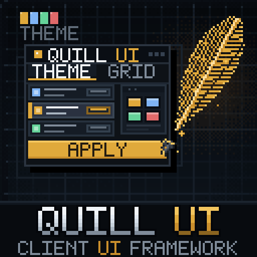

# Quill UI



A small, opinionated **client-side UI framework for Fabric** (Minecraft 26.3, Java 25).

Quill UI provides the visual and layout foundation used by LaborCraft: theme tokens, panel/header
primitives, cards, tabs, buttons, scrollable lists and a backend action boundary. It is deliberately
independent from any economy, jobs or gameplay code, so other mods can use it.

## Status

`0.2.0-alpha.6` — form controls, screen overlays (popup, modal, toast) and the input/overlay test
screens, on top of the motion, text, HUD and map foundation. The API is intentionally small and may
evolve before a
stable `1.0.0`. This build is published on the **alpha** channel, not as a stable release.
The public API surface and compatibility policy are documented in
[docs/API.md](docs/API.md) and [docs/COMPATIBILITY.md](docs/COMPATIBILITY.md).

## Modules

| Area | Package | Entry points |
| --- | --- | --- |
| Theme | `com.quillui.theme` | `QuillThemeData`, `QuillTheme`, `QuillSpacing`, `QuillTypography`, `QuillRadii`, `QuillElevation` |
| Colours | `com.quillui.theme` | `QuillColors` |
| Layout | `com.quillui.layout` | `QuillRect`, `QuillInsets`, `QuillColumn`, `QuillRow`, `QuillGrid` |
| Drawing | `com.quillui.render` | `QuillRender`, `QuillTooltips` |
| Widgets | `com.quillui.widget` | `QuillButton`, `QuillCard`, `QuillPanel`, `QuillScrollList`, `QuillTabBar`, `QuillToggle`, `QuillTextField`, `QuillSlider`, `QuillCheckbox`, `QuillRadio`, `QuillRadioGroup`, `QuillDropdown` |
| Screen | `com.quillui.screen` | `QuillScreen` |
| Backend boundary | `com.quillui.action` | `QuillActionSink`, `QuillCommandSink` |
| Map | `com.quillui.map` | `QuillMap`, `QuillMapZone`, `QuillMapMarker` |
| HUD | `com.quillui.hud` | `QuillTargetIndicator`, `QuillTargetIndicatorHud` |
| Motion | `com.quillui.motion` | `QuillTicker`, `QuillAnimation`, `QuillCurves`, `QuillTransition`, `QuillMotion` |
| Text | `com.quillui.text` | `QuillText`, `QuillTextStyle` |
| Input styles | `com.quillui.input` | `QuillSelectionStyle`, `QuillSelectionStyles` |
| i18n | `com.quillui.i18n` | `QuillLanguage` |
| Overlays | `com.quillui.overlay` | `QuillOverlay`, `QuillPopupMenu`, `QuillModal`, `QuillToast` |
| Compatibility | `com.quillui.api` | `QuillApi` |

## Build

```bat
gradlew.bat build --console=plain --no-daemon
```

The jar is written to `build/libs/quill-ui-0.2.0-alpha.6.jar`.

## Install

Quill UI is a separate client mod. Put its jar next to Fabric API in `mods/`. Mods that compile
against it should declare it as a dependency; it has no LaborCraft dependency. Dedicated servers do
not need this jar; client screens that use it do.

## Quick start

```java
import com.quillui.action.QuillCommandSink;
import com.quillui.layout.QuillColumn;
import com.quillui.layout.QuillRect;
import com.quillui.screen.QuillScreen;
import com.quillui.theme.QuillSpacing;
import com.quillui.widget.QuillButton;

public final class ExampleScreen extends QuillScreen {
    public ExampleScreen() {
        super(Component.literal("Example"), 420, 260);
    }

    @Override
    protected void buildContent() {
        int x = panelX + QuillSpacing.SPACE_4;
        int width = panelWidth() - QuillSpacing.SPACE_4 * 2;
        QuillColumn column = new QuillColumn(x, panelY + 60, width, QuillSpacing.SPACE_2);

        QuillRect first = column.next(24);
        QuillButton button = new QuillButton(
                first.x(), first.y(), first.width(), first.height(),
                Component.literal("Run action"),
                QuillButton.Variant.PRIMARY,
                () -> QuillCommandSink.get().execute("example run")
        );
        addRenderableWidget(button);
        addRenderableWidget(closeButton(this::onClose));
    }

    @Override
    protected Component subtitle() {
        return Component.literal("A Quill UI example.");
    }
}
```

## Design rules

- Use `QuillThemeData`/token classes instead of literal colours/spacing.
- Derive positions with layout primitives; do not repeat magic `x/y` values across screens.
- A screen renders state; it never mutates game state. Every action goes through an
  `QuillActionSink` (or a project-specific C2S payload).
- Keep cards and action rows on the same 4 px grid.

## License

GNU Lesser General Public License v3.0 or later. See [LICENSE](LICENSE).

## Documentation

- [Documentation website](https://netottt.github.io/quill-ui-docs/) ([source](https://github.com/NetoTTT/quill-ui-docs))
- [Getting started](docs/01-GETTING-STARTED.md)
- [Theme tokens](docs/02-THEME.md)
- [Layout](docs/03-LAYOUT.md)
- [Widgets and screen](docs/04-WIDGETS.md)
- [Actions and backend](docs/05-ACTIONS.md)
- [Migrating from LaborCraft's LC UI](docs/06-MIGRATION.md)
- [Input styles](docs/10-INPUT-STYLES.md)
- [Internationalization](docs/11-I18N.md)
- [Overlays](docs/12-OVERLAYS.md)
- [Integration modes](docs/07-INTEGRATION.md)
- [Public API](docs/API.md)
- [Compatibility policy](docs/COMPATIBILITY.md)
- [Colours](docs/08-COLORS.md)
- [Token groups](docs/09-TOKENS.md)
- [Roadmap, including future NeoForge port](docs/ROADMAP.md)
- [Architecture](ARCHITECTURE.md)
- [Contributing](CONTRIBUTING.md)
- [Supported Minecraft versions](docs/SUPPORTED-VERSIONS.md)
